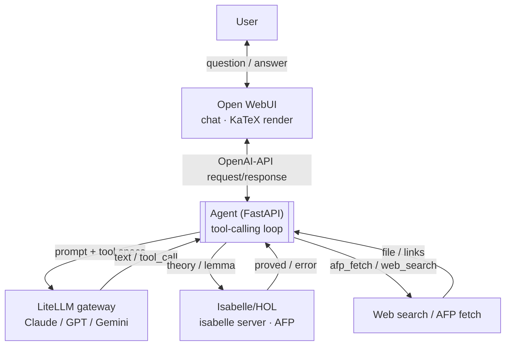

# Agent for Formal Proofs in Isabelle/HOL

*Architecture design — working draft, 2026-10-10*

A containerized system that connects a cloud LLM (Claude / GPT / Gemini) to a
local formal apparatus — Isabelle/HOL and the Archive of Formal Proofs — so
the agent can not only propose a mathematical statement but also have it
machine-verified. The whole stack is generated from a single configuration
schema, not a hand-written compose file.

> **Why this can work even with an imperfect agent.** Isabelle is an
> LCF-style prover — it has a small, trusted kernel that alone decides
> whether a proof is valid. The agent (and the LLM behind it) may propose,
> guess, translate from other systems, or search the web arbitrarily
> unreliably — if the resulting proof script doesn't pass the Isabelle
> kernel, it's discarded, not silently accepted. The architecture therefore
> doesn't need to solve LLM trustworthiness; it only needs to ensure that
> *nothing counts as proved until Isabelle says so*.

## §1 Concepts and layers

The brief slightly conflates the terms "Ollama" and "agent" into three
different things. We distinguish them from the start, since the rest of the
design rests on it.

| Term | What it is |
|---|---|
| **Open WebUI** | Chat frontend (formerly "Ollama WebUI"). Model-agnostic, supports KaTeX rendering of LaTeX in the conversation and has its own authentication including OAuth. |
| **Ollama** | Runtime for local open-weight models. In this project an *optional future branch* — the core of the task is solved by a cloud LLM + local tools, not local inference. |
| **LiteLLM gateway** | A proxy that hides Claude, GPT, Gemini (and later Ollama) behind a single OpenAI-compatible API. The only place where API keys live. |
| **Agent** | A standalone service (FastAPI/Python) that drives the tool-calling loop between the LLM and local tools. The new, purpose-built core of the project. |
| **Isabelle/HOL** | Proof assistant with the HOL object logic. Runs as `isabelle server` — a line-based JSON-over-TCP protocol for submitting theories and reading results. |
| **AFP** | Archive of Formal Proofs — a public collection of finished Isabelle theories (isa-afp.org), released for each Isabelle version. |

## §2 Architecture

The agent is the only node that talks to both the LLM and the tools. Nothing
else connects directly to Isabelle or to the web.



The agent repeats the loop of calling the LLM + tools until the LLM has
enough information for a final answer.

**A concrete walkthrough:**

1. The user types into Open WebUI: *"Prove that there are infinitely many
   primes."*
2. The agent sends the query + tool descriptions through LiteLLM to
   Claude/GPT/Gemini.
3. The LLM returns `tool_call: afp_search("infinitude of primes")` — the
   agent finds that the proof already exists in AFP and downloads the entry.
4. The agent sends the theory to `isabelle server`; it compiles it and
   returns `proved` or a specific error.
5. The result (verified by the Isabelle kernel, not just asserted by the
   LLM) is returned to the LLM, which composes an answer for the user from
   it.
6. The answer includes links to download the `.thy` file and the typeset PDF
   proof (§5) — clicking downloads directly from the agent.

**Component responsibilities:**

| Component | Technology | Responsibility |
|---|---|---|
| `webui` | Open WebUI | Conversation, LaTeX rendering, user authentication |
| `agent` | FastAPI (Python) | Tool-calling loop, contract with WebUI, routing to Isabelle / web / AFP, serving output files (§5) |
| `llm-gateway` | LiteLLM | Unified API over Claude/GPT/Gemini, API key storage |
| `isabelle` | Isabelle/HOL + AFP | `isabelle server`, proof verification, concurrent sessions per user |
| `ollama` *(later)* | Ollama | Local models — same OpenAI-compatible interface, added without refactoring |

> **Correction from the Phase 1 investigation:** `isabelle server` binds
> only to `localhost` — this is a property of Isabelle (a security
> restriction), not our choice, and it can't be reached by container name
> over the compose network. The agent therefore runs with
> `network_mode: "service:isabelle"` (sharing the network namespace with the
> `isabelle` container as a sidecar) — from the agent's point of view, the
> server is then reachable at `localhost:<port>`. The diagram and data flow
> above remain valid; only the transport between the agent and Isabelle is
> via the shared namespace instead of the docker network.

## §3 Design decisions

Five choices that determine the shape of the rest of the system.

| Question | Chosen | Why / path forward |
|---|---|---|
| Local models | Cloud only for now, Ollama optionally later | Local HW isn't enough for strong models; but a cloud LLM lacks mathematical tools. Ollama connects via the same OpenAI-compatible interface, no refactor. |
| Agent layer | Standalone FastAPI service | Full control over tool-calling and over the `isabelle server` protocol, independent of what Open WebUI natively supports. |
| Users | Single-user for now, multi-user ready | Open WebUI has OAuth + whitelist natively. `user_id`/`session_id` is a required parameter in both the agent and the Isabelle session from the first version. `session_id` now actually isolates one conversation's Isabelle session (and workspace directory) from others, with an LRU cap on the number of concurrent sessions (`AGENT_MAX_ISABELLE_SESSIONS`). |
| Building the stack | Generate from a configuration schema (§4), not hand-write compose | One instance = one `config.yaml` + running the builder. The same Pydantic model validates the config and drives the agent's runtime — one source of truth, not four files to sync by hand. |
| Downloading outputs | Signed, time-limited links directly to the agent (§5) | No WebUI plugin — Open WebUI just renders a markdown link. The token carries its own authorization, without depending on a shared auth cookie with WebUI, so it works the same in both the single-user and multi-user phases. |

## §4 Configuration as code

No hand-written `compose.yaml`. A single configuration schema from which the
stack is built "to order" for a specific deployment.

At the core is a single Pydantic model in the agent — simultaneously the
schema for validating the config file and the runtime `Settings` object that
the agent loads at startup. The same source of truth thus governs both what
gets registered with the agent as an LLM tool and which containers get
generated with which variables.

```yaml
# config.yaml — one deployment, one stack instance
backends:
  claude:  {enabled: true,  model: claude-opus-4}
  gpt:     {enabled: false}
  gemini:  {enabled: false}
  ollama:  {enabled: false}

tools:
  isabelle:    {enabled: true}
  afp_search:  {enabled: true}
  web_search:  {enabled: false}

auth:
  mode: single_user   # or: oauth_whitelist
  whitelist: []
```

`builder.py` loads and validates `config.yaml` against the Pydantic model
and renders (Jinja2) three artifacts from it that can be run directly:

- `compose.yaml` — only the services the given configuration actually needs
  (no `ollama` service if `enabled: false`).
- `litellm-config.yaml` — only the enabled backends and their models.
- runtime config for `agent` — which `tools/*.py` get registered at startup
  as function-calling specs for the LLM.

Result: adding/removing a backend or tool is a one-field change in YAML plus
re-running the builder, not a manual edit of four files at once. The builder
itself doesn't run as a service — it's a one-off (CI/local) step before
`docker compose up` / `podman compose up`.

## §5 Output files and downloads

The result of a conversation need not be just text in the chat — it can be a
formal theory, a typeset proof, or a draft paper skeleton. All of that must
be downloadable from the UI.

| Artifact | How it's produced | Format |
|---|---|---|
| Formal theory | agent-verified/created Isabelle source | `.thy` |
| Typeset proof | Isabelle's own document preparation (`isabelle build -D`) — the same LaTeX Isabelle already needs for its own documentation, not a new dependency | PDF |
| Paper skeleton | LLM draft (best-effort, informal), optionally typeset with the same LaTeX toolchain | Markdown / PDF |

The mechanism deliberately introduces no new component: the agent saves the
output to `data/<user_id>/artifacts/` and inserts a plain markdown link into
the chat response with a signed, time-limited token (artifact name +
`user_id` + expiry, HMAC) — just like a presigned S3 URL. Open WebUI renders
such a link as a clickable link without any plugin; clicking goes directly
to the agent's `/files/…` endpoint, not through WebUI. The token carries its
own authorization, so it already works in the single-user phase and nothing
needs to change once OAuth is added in Phase 4.

## §6 Containers: Docker and Podman

One `compose.yaml`, no engine-specific extensions.

- Stick to the plain Compose Specification — no swarm/bake features that
  Podman doesn't read.
- Named volumes instead of bind mounts with a fixed UID — rootless Podman
  maps UIDs differently than Docker.
- Since v4, Podman supports `podman compose` (delegating to
  podman-compose/docker-compose) over the same file — test on both engines
  in practice; the most common snag is the SELinux `:Z` label on volumes,
  which Docker doesn't need.

## §7 State and security

- API keys for Claude/GPT/Gemini live only in `llm-gateway`, never in the
  WebUI configuration.
- Only `agent` has network access for web search and downloading libraries —
  the Isabelle container doesn't need internet access at all.
- `isabelle server` is additionally bound only to `localhost` of the network
  namespace shared with the agent (see §2) — its port isn't published
  either to the rest of the stack or to the host. A smaller attack surface
  than if it were an ordinary network service.
- Persistent state (conversations, downloaded AFP entries, Isabelle heaps,
  output artifacts from §5) is stored per-user from the start:
  `data/<user_id>/…`, not in a single shared directory.
- LiteLLM later supports per-user virtual keys and quotas — doesn't need to
  be addressed in the MVP, but is available.

## §8 Limitation: proofs from other systems

Searching for "existing formal proofs on the web" has two very different
levels of difficulty.

**Mechanical — AFP.** If the proof is already in Isabelle/HOL (typically an
AFP entry), it's a matter of downloading + compiling via `isabelle server`.
It either passes the kernel or it doesn't — no additional uncertainty.

**Best-effort — another formal system.** If the proof is in Lean/mathlib,
Coq, Metamath, etc., there's no general decision procedure for converting it
into Isabelle/HOL — between systems with different logical kernels, this may
not even be a mathematically decidable problem. The agent can therefore only
offer **translation/reformulation via the LLM**, not a guaranteed
conversion. A translation never counts as a proof on its own — it holds only
if the resulting Isabelle script passes the kernel again (see the opening
note about the LCF kernel).

## §9 Implementation phases

0. **WebUI + LiteLLM.** Minimal `config.yaml` (one backend) → the builder
   generates `compose.yaml`; Open WebUI connected via LiteLLM, verify LaTeX
   rendering in the conversation.
1. **Isabelle/HOL + AFP.** Image with Isabelle and a downloaded AFP,
   `isabelle server` running, manual smoke test (connection, checking one
   theory).
2. **Agent service.** FastAPI agent with the tool-calling loop and tools for
   Isabelle; `user_id`/`session_id` in the contract from the first version;
   artifacts and signed download links from §5.
3. **AFP search/fetch + web search.** Searching the AFP index, downloading
   entries; a general web search tool for external libraries (best-effort
   branch, §8).
4. **Hardening.** OAuth + whitelist in Open WebUI if more users are added;
   review of the agent's network isolation.

## §10 Open questions

- **isabelle-client (Python):** confirmed to exist and be actively
  maintained ([inpefess/isabelle-client](https://github.com/inpefess/isabelle-client),
  PyPI `isabelle-client`, ~1.1.1, Python 3.6+) — specific compatibility with
  Isabelle2025-2 still needs to be verified during Phase 2 implementation.
- **Source for web search:** which search API/service for the
  `web_search_proofs` tool — affects cost and rate limits.
- **AFP indexing:** is a static index of entries from isa-afp.org enough, or
  do we also want semantic search over it?
- **OAuth provider for Phase 4:** Google/GitHub/generic OIDC — a choice to
  make once there are more users.
- **Builder:** templating via Jinja2 is the default choice, but verify it
  before it accumulates many templates — also whether the schema is
  versioned (what happens to an old `config.yaml` when the schema is
  extended).
- **LaTeX toolchain for §5:** full TeXLive (large image) vs. a lightweight
  alternative (e.g. Tectonic) for typesetting PDF outputs — the choice
  affects the size of the Isabelle image.

---

*Working draft — evolves with the project. Live version with diagram:
https://claude.ai/code/artifact/701ea8e1-15f2-49cc-ab90-72c9f47b2472*
