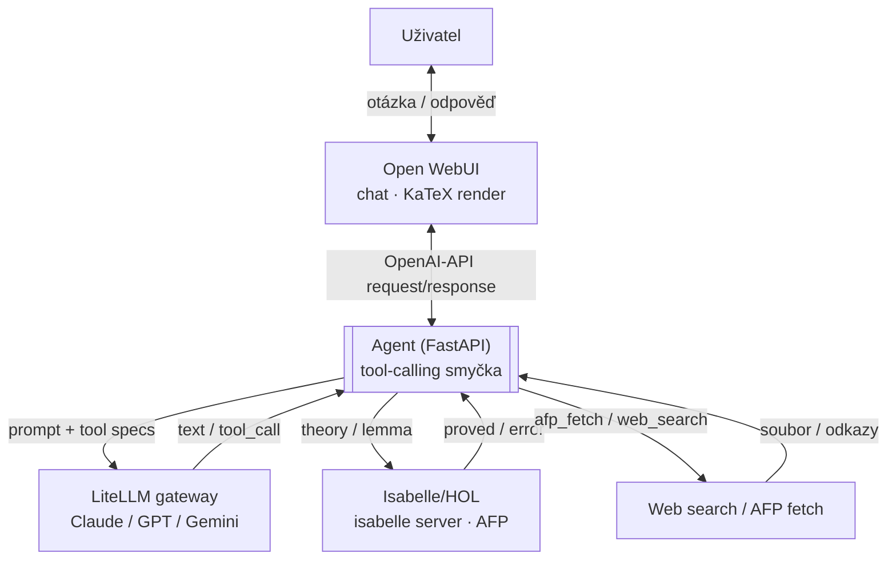

# Agent pro formální důkazy v Isabelle/HOL

*Návrh architektury — pracovní verze, 2026-10-10*

Kontejnerový systém, který propojí cloudový LLM (Claude / GPT / Gemini) s
lokálním formálním aparátem — Isabelle/HOL a Archive of Formal Proofs — tak,
aby agent mohl matematické tvrzení nejen navrhnout, ale i nechat strojově
ověřit. Celý stack se generuje z jednoho konfiguračního schématu, ne z ručně
psaného compose souboru.

> **Proč to může fungovat i s nedokonalým agentem.** Isabelle je LCF-style
> dokazovač — má malé, důvěryhodné jádro, které jako jediné rozhoduje, zda je
> důkaz platný. Agent (a LLM pod ním) může navrhovat, hádat, překládat z
> jiných systémů nebo hledat na webu libovolně nespolehlivě — pokud výsledný
> důkazní skript neprojde jádrem Isabelle, je zahozen, ne tiše přijat.
> Architektura proto nemusí řešit důvěryhodnost LLM; musí jen zajistit, že
> *nic se nepovažuje za dokázané, dokud to neřekne Isabelle*.

## §1 Pojmy a vrstvy

Zadání pojmy "Ollama" a "agent" mírně slučuje tři různé věci. Rozlišujeme je
od začátku, protože na tom stojí zbytek návrhu.

| Pojem | Co to je |
|---|---|
| **Open WebUI** | Chatovací frontend (dřívější "Ollama WebUI"). Model-agnostický, umí KaTeX render LaTeXu v konverzaci a vlastní autentizaci včetně OAuth. |
| **Ollama** | Runtime pro lokální open-weight modely. V tomto projektu *volitelná budoucí větev* — jádro úlohy řeší cloudový LLM + lokální nástroje, ne lokální inference. |
| **LiteLLM gateway** | Proxy, která pod jedním OpenAI-kompatibilním API schová Claude, GPT, Gemini (a později Ollamu). Jediné místo, kde žijí API klíče. |
| **Agent** | Samostatná služba (FastAPI/Python), která vede tool-calling smyčku mezi LLM a lokálními nástroji. Nové, na míru psané jádro projektu. |
| **Isabelle/HOL** | Proof assistant s objektovou logikou HOL. Běží jako `isabelle server` — řádkový JSON-přes-TCP protokol pro zadávání teorií a čtení výsledků. |
| **AFP** | Archive of Formal Proofs — veřejná sbírka hotových Isabelle teorií (isa-afp.org), vydávaná pro každou verzi Isabelle. |

## §2 Architektura

Agent je jediný uzel, který mluví s LLM i s nástroji. Nic jiného se k
Isabelle ani na web nepřipojuje přímo.



Agent opakuje smyčku volání LLM + nástrojů, dokud LLM nemá dost informací na
hotovou odpověď.

**Konkrétní průchod:**

1. Uživatel napíše do Open WebUI: *"Dokaž, že prvočísel je nekonečně mnoho."*
2. Agent poslá dotaz + popis nástrojů přes LiteLLM na Claude/GPT/Gemini.
3. LLM vrátí `tool_call: afp_search("infinitude of primes")` — agent zjistí,
   že důkaz už existuje v AFP, a stáhne entry.
4. Agent pošle teorii na `isabelle server`; ten ji zkompiluje a vrátí
   `proved` nebo konkrétní chybu.
5. Výsledek (ověřeno jádrem Isabelle, ne jen tvrzením LLM) se vrátí LLM,
   které z něj sestaví odpověď pro uživatele.
6. Odpověď obsahuje odkazy na stažení `.thy` souboru a typeset PDF důkazu
   (§5) — klik stáhne přímo z agenta.

**Odpovědnosti komponent:**

| Komponenta | Technologie | Odpovědnost |
|---|---|---|
| `webui` | Open WebUI | Konverzace, LaTeX render, autentizace uživatelů |
| `agent` | FastAPI (Python) | Tool-calling smyčka, kontrakt vůči WebUI, routování na Isabelle / web / AFP, výdej výstupních souborů (§5) |
| `llm-gateway` | LiteLLM | Jednotné API nad Claude/GPT/Gemini, úložiště API klíčů |
| `isabelle` | Isabelle/HOL + AFP | `isabelle server`, ověření důkazů, souběžné session per uživatel |
| `ollama` *(později)* | Ollama | Lokální modely — stejné OpenAI-kompatibilní rozhraní, přidá se bez refaktoru |

> **Oprava z Fáze 1 průzkumu:** `isabelle server` se váže jen na `localhost`
> — je to vlastnost Isabelle (bezpečnostní omezení), ne naše volba, a nejde
> ho zavolat přes jméno kontejneru po compose síti. Agent proto poběží s
> `network_mode: "service:isabelle"` (sdílí network namespace s `isabelle`
> kontejnerem jako sidecar) — z pohledu agenta je pak server dostupný na
> `localhost:<port>`. Diagram a tok dat výše zůstávají platné, jen přenos
> mezi agentem a Isabelle není přes docker síť, ale přes sdílený namespace.

## §3 Rozhodnutí z návrhu

Pět voleb, které určují tvar zbytku systému.

| Otázka | Zvoleno | Proč / cesta dál |
|---|---|---|
| Lokální modely | Jen cloud teď, Ollama volitelně později | Lokální HW na silné modely nestačí; cloud LLM ale nemá matematické nástroje. Ollama se připojí stejným OpenAI-kompatibilním rozhraním, žádný refaktor. |
| Agent vrstva | Samostatná FastAPI služba | Plná kontrola nad tool-callingem a nad protokolem `isabelle server`, nezávislá na tom, co umí Open WebUI nativně. |
| Uživatelé | Single-user teď, multi-user připraveno | Open WebUI má OAuth + whitelist nativně. `user_id`/`session_id` je povinný parametr v agentu i v Isabelle session od první verze. `session_id` nyní skutečně oddělí Isabelle session (a workspace adresář) jedné konverzace od ostatních, s LRU stropem na počet souběžných sessions (`AGENT_MAX_ISABELLE_SESSIONS`). |
| Sestavení stacku | Generovat z konfiguračního schématu (§4), ne ručně psát compose | Jedna instance = jeden `config.yaml` + spuštění builderu. Stejný Pydantic model validuje config i řídí runtime agenta — jeden zdroj pravdy, ne čtyři soubory k ruční synchronizaci. |
| Stahování výstupů | Signed, časově omezené odkazy přímo na agenta (§5) | Žádný WebUI plugin — Open WebUI jen vykreslí markdown link. Token nese autorizaci sám, bez závislosti na sdíleném auth cookie s WebUI, takže funguje stejně v single-user i multi-user fázi. |

## §4 Konfigurace jako kód

Žádný ručně psaný `compose.yaml`. Jedno konfigurační schéma, ze kterého se
stack sestaví "na zakázku" pro konkrétní nasazení.

Jádrem je jeden Pydantic model v agentu — zároveň schéma pro validaci
konfiguračního souboru, zároveň runtime `Settings` objekt, který si agent
načte při startu. Stejný zdroj pravdy tak řídí, co se agentovi zaregistruje
jako nástroj pro LLM, i to, jaké kontejnery a s jakými proměnnými se
vygenerují.

```yaml
# config.yaml — jedno nasazení, jedna instance stacku
backends:
  claude:  {enabled: true,  model: claude-opus-4}
  gpt:     {enabled: false}
  gemini:  {enabled: false}
  ollama:  {enabled: false}

tools:
  isabelle:    {enabled: true}
  afp_search:  {enabled: true}
  web_search:  {enabled: false}

auth:
  mode: single_user   # nebo: oauth_whitelist
  whitelist: []
```

`builder.py` načte a validuje `config.yaml` proti Pydantic modelu a z něj
vyrenderuje (Jinja2) tři artefakty, které jde rovnou spustit:

- `compose.yaml` — jen služby, které daná konfigurace skutečně potřebuje
  (bez `ollama` service, pokud je `enabled: false`).
- `litellm-config.yaml` — jen povolené backendy a jejich modely.
- runtime config pro `agent` — která `tools/*.py` se při startu zaregistrují
  jako function-calling specs pro LLM.

Výsledek: přidat/odebrat backend nebo nástroj je změna jednoho pole v YAML a
opětovné spuštění builderu, ne ruční úprava čtyř souborů najednou. Builder
sám neběží jako služba — je to jednorázový (CI/lokální) krok před
`docker compose up` / `podman compose up`.

## §5 Výstupní soubory a stahování

Výsledkem konverzace nemusí být jen text v chatu — je to formální teorie,
typeset důkaz, nebo rozpracovaná kostra článku. To všechno musí jít z UI
stáhnout.

| Artefakt | Vzniká jak | Formát |
|---|---|---|
| Formální teorie | agentem ověřený/vytvořený Isabelle zdroj | `.thy` |
| Typeset důkaz | Isabelle vlastní document-preparation (`isabelle build -D`) — stejný LaTeX, co Isabelle už potřebuje pro svou dokumentaci, ne nová závislost | PDF |
| Kostra článku | LLM návrh (best-effort, neformální), volitelně sazba stejným LaTeX toolchainem | Markdown / PDF |

Mechanismus je záměrně bez nové komponenty: agent uloží výstup do
`data/<user_id>/artifacts/` a do odpovědi v chatu vloží obyčejný markdown
odkaz s podepsaným, časově omezeným tokenem (jméno artefaktu + `user_id` +
expirace, HMAC) — stejně jako presigned URL u S3. Open WebUI takový odkaz
vykreslí jako klikatelný link bez jakéhokoli pluginu; klik jde přímo na
agentův `/files/…` endpoint, ne přes WebUI. Token nese autorizaci sám, takže
to funguje už v single-user fázi a nic se nemusí měnit, až v Fázi 4 přibude
OAuth.

## §6 Kontejnery: Docker i Podman

Jeden `compose.yaml`, žádná enginu-specifická rozšíření.

- Drží se čisté Compose Specification — žádné swarm/bake featury, které
  Podman nečte.
- Named volumes místo bind mountů s pevným UID — rootless Podman mapuje UID
  jinak než Docker.
- Podman od v4 umí `podman compose` (delegace na podman-compose/docker-compose)
  nad stejným souborem — reálně odzkoušet na obou enginech, nejčastější
  zádrhel bývá SELinux `:Z` label na volumech, který Docker nepotřebuje.

## §7 Stav a bezpečnost

- API klíče pro Claude/GPT/Gemini žijí jen v `llm-gateway`, nikdy v
  konfiguraci WebUI.
- Jen `agent` má síťový přístup pro web search a stahování knihoven —
  Isabelle kontejner nemusí mít internet vůbec.
- `isabelle server` je navíc vázaný jen na `localhost` sdíleného network
  namespace s agentem (viz §2) — jeho port se nepublikuje ani do zbytku
  stacku, ani na hostitele. Menší attack surface, než kdyby šlo o běžnou
  síťovou službu.
- Perzistentní stav (konverzace, stažené AFP entries, Isabelle heapy,
  výstupní artefakty z §5) ukládán per-uživatel od začátku:
  `data/<user_id>/…`, ne do jednoho sdíleného adresáře.
- LiteLLM později umí per-user virtuální klíče a kvóty — nemusí se řešit v
  MVP, ale k dispozici je.

## §8 Omezení: důkazy z jiných systémů

Hledání "existujících formálních důkazů na webu" má dvě velmi odlišné
obtížnosti.

**Mechanické — AFP.** Pokud je důkaz už v Isabelle/HOL (typicky AFP entry),
jde o stažení + zkompilování přes `isabelle server`. Buď to projde jádrem,
nebo ne — žádná nejistota navíc.

**Best-effort — jiný formální systém.** Pokud je důkaz v Lean/mathlib, Coq,
Metamath apod., neexistuje obecný rozhodovací postup, jak ho převést do
Isabelle/HOL — mezi systémy s různými logickými jádry to ani nemusí být
matematicky rozhodnutelná úloha. Agent proto může nabídnout jen
**překlad/reformulaci pomocí LLM**, ne garantovaný převod. Překlad se nikdy
nepočítá jako důkaz sám o sobě — platí, jen pokud výsledný Isabelle skript
znovu projde jádrem (viz úvodní poznámka o LCF jádru).

## §9 Fáze implementace

0. **WebUI + LiteLLM.** Minimální `config.yaml` (jeden backend) → builder
   vygeneruje `compose.yaml`; Open WebUI napojené přes LiteLLM, ověřit LaTeX
   rendering v konverzaci.
1. **Isabelle/HOL + AFP.** Image s Isabelle a stáhnutou AFP, `isabelle server`
   nahoře, ruční smoke test (připojení, kontrola jedné teorie).
2. **Agent služba.** FastAPI agent s tool-calling smyčkou a nástroji pro
   Isabelle; `user_id`/`session_id` v kontraktu od první verze; artefakty a
   signed download odkazy z §5.
3. **AFP search/fetch + web search.** Vyhledávání v AFP indexu, stahování
   entries; obecný web search nástroj pro externí knihovny (best-effort
   větev, §8).
4. **Hardening.** OAuth + whitelist v Open WebUI, pokud přibydou další
   uživatelé; revize síťové izolace agenta.

## §10 Otevřené otázky

- **isabelle-client (Python):** ověřeno, že existuje a je aktivně udržovaný
  ([inpefess/isabelle-client](https://github.com/inpefess/isabelle-client),
  PyPI `isabelle-client`, ~1.1.1, Python 3.6+) — zbývá ověřit konkrétní
  kompatibilitu s Isabelle2025-2 až při implementaci Fáze 2.
- **Zdroj pro web search:** která search API/služba pro nástroj
  `web_search_proofs` — ovlivní náklady a rate limity.
- **AFP indexace:** stačí statický index entries z isa-afp.org, nebo
  chceme nad ním i sémantické vyhledávání?
- **OAuth provider pro Fázi 4:** Google/GitHub/generic OIDC — volba až bude
  víc uživatelů.
- **Builder:** šablonování přes Jinja2 je výchozí volba, ale ověřit, než se
  v něm natvoří hodně šablon — i zda se schéma verzuje (co se stane se
  starým `config.yaml` při rozšíření schématu).
- **LaTeX toolchain pro §5:** plný TeXLive (velký image) vs. odlehčená
  alternativa (např. Tectonic) pro sazbu PDF výstupů — volba ovlivní
  velikost Isabelle image.

---

*Pracovní návrh — vyvíjí se s projektem. Živá verze s diagramem:
https://claude.ai/code/artifact/701ea8e1-15f2-49cc-ab90-72c9f47b2472*
